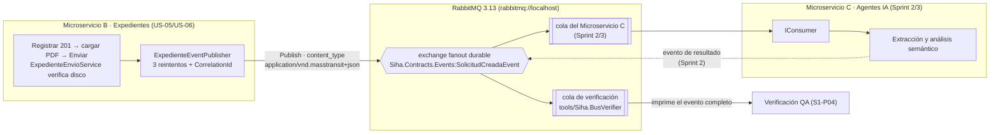

# Contrato del evento `SolicitudCreadaEvent`

**Proyecto:** SIHA-IA · Sistema Inteligente de Homologación Académica Asistido por Agentes IA
**Institución:** Universidad Técnica de Ambato — FISEI — Metodologías Ágiles
**Sprint:** 1 (Base del Sistema) · **Tarea:** S1-P01
**Autor:** Paul Medardo Acurio López — Product Owner Proxy & QA/AI Lead
**Versión del documento:** 1.1 · **Versión del contrato:** 1.1 · **Estado:** Implementado; coordinación de esta revisión pendiente
**Fecha:** 18 de octubre de 2026 · **Revisión 1.1:** 19 de octubre de 2026 (Sebastián Miranda — integración de documentos)

> **Cambios de la versión 1.1 (aditivos, regla EV-02):**
> 1. El evento se publica solo cuando el expediente pasa de `PENDIENTE_DOCUMENTOS` a enviado y
>    todos los documentos referenciados están en estado `VALIDADO`, existen en el almacenamiento y su
>    SHA-256 se **recalculó desde disco** justo antes de publicar. Ningún dato del cliente llega al bus.
> 2. Nuevo campo 13 `Documentos` (al final del contrato): referencia verificada de cada PDF
>    (`DocumentoId`, `RutaAlmacenamiento` relativa al volumen de B, `HashSha256`, `TamanoBytes`).
>    No transporta binarios (R-01 se mantiene). `DocumentoIds` se conserva por compatibilidad.
> 3. `MessageId` del envelope = `ExpedienteId`: si un reintento llegara a publicar dos veces, el
>    consumidor puede descartar el duplicado. El `CorrelationId` sigue siendo el original.
> 4. `Version` = `"1.1"`.

---

## Coordinación pendiente (20 de octubre de 2026)

No hay canal de contacto disponible en esta sesión: **no se contactó a Sebastián ni a Alex y no consta su aceptación**. Pendiente revisar con ambos el flujo borrador → carga → enviar, la presentación de errores 422 y la evidencia de recepción independiente.

- Registrar devuelve **201** y no publica. Cargar PDF devuelve **201** (o **200** por contenido repetido). Solo `/enviar` o `/republicar` publican mediante `ExpedienteEnvioService`.
- Si un adjunto previamente `VALIDADO` falta o cambia de tamaño/SHA-256, devuelve **422 sin publicar un subconjunto**, aunque otro PDF cumpla el mínimo. Queda `NO_DISPONIBLE`, con motivo consultable; el expediente vuelve a `PENDIENTE_DOCUMENTOS`.
- Reintentar no omite ese fallo: recargar el mismo contenido (hash y tamaño calculados por B) y usar `/enviar`. La referencia antigua se conserva como auditoría y solo la nueva validada viaja. `RECHAZADO` y `RETIRADO` no bloquean. No hay relación explícita de reemplazo por contenido diferente.
- **202 no demuestra recepción**: puede incluir `publicado=false` por fallo del bus. Incluso `publicado=true` no prueba consumo por C. Exigir recepción en suscriptor independiente con `ExpedienteId`, `CorrelationId`, `MessageId` y referencias contrastadas con DB B/disco.
- `RutaAlmacenamiento` es relativa al almacenamiento de B, no una URL pública ni autorización de acceso. **El mecanismo autorizado de acceso de C sigue pendiente de decisión** con el equipo; no se agrega ni se promete un endpoint de descarga.
- Verificación local de esta revisión: pruebas con InMemory/Moq son **simuladas**; la nueva regresión SQL Server/RabbitMQ queda preparada, **no ejecutada** por Docker no disponible. No hay nueva evidencia E2E ni aceptación de C.

---

## 1. Objetivo y alcance

Este documento es el **contrato formal del evento `SolicitudCreadaEvent`**, mensaje asíncrono que el
**Microservicio B** (Expedientes) publica en **RabbitMQ** para que el **Microservicio C** (Agentes IA /
análisis semántico) ejecute el procesamiento de contenidos.

Alcance:

- Definir la **estructura completa** del mensaje (campos, tipos, obligatoriedad y ejemplos).
- Fijar el **rol del `CorrelationId`** como hilo de trazabilidad extremo a extremo.
- Fijar los **metadatos mínimos** de transporte que todo consumidor puede exigir.
- Establecer la regla inquebrantable de que **NO se adjuntan archivos binarios**; solo **referencias**.
- Documentar el **diagrama de intercambio B → RabbitMQ → C**.

Fuera de alcance: el algoritmo de homologación del Microservicio C, la validación binaria de PDF
(tarea S1-S05/S1-S06 de Sebastián) y el almacenamiento seguro de documentos.

**Definición canónica en código:** `src/BuildingBlocks/Siha.Contracts/Events/SolicitudCreadaEvent.cs`
(proyecto `Siha.Contracts`, único origen de verdad para B y C).

---

## 2. Estructura formal del evento

Tipo .NET: `public sealed record SolicitudCreadaEvent` (`Siha.Contracts.Events`, `net8.0`).

| # | Campo | Tipo .NET | Tipo JSON | Obligatorio | Descripción | Ejemplo |
|---|---|---|---|---|---|---|
| 1 | `ExpedienteId` | `Guid` | string (uuid) | **Sí** | Clave primaria del expediente persistido en **DB B**. Es la llave de conciliación del lado de C. | `bef8ef40-14a2-4c22-ab78-ca1ddb072468` |
| 2 | `CorrelationId` | `Guid` | string (uuid) | **Sí** | Identificador de correlación extremo a extremo. Generado **una sola vez** por B al registrar el expediente y conservado en cada reintento/republicación. No se regenera jamás. | `5160c9cd-552b-4607-ae2b-67a6c85fc063` |
| 3 | `CodigoExpediente` | `string` | string | **Sí** | Código legible del expediente (prefijo + fecha + secuencia). Es el identificador que usa el operador en la interfaz. | `EXP-20261018-4F9B2C` |
| 4 | `TipoTramite` | `string` | string | **Sí** | Tipo de trámite. Dominio cerrado: `INTERNO` \| `EXTERNO` (`TiposTramite`). | `INTERNO` |
| 5 | `RutaNormativa` | `string` | string | **Sí** | Ruta normativa institucional aplicable. Dominio cerrado: `CAU-P-011` \| `CAU-P-122` (`RutasNormativas`). | `CAU-P-011` |
| 6 | `CarreraOrigenCodigo` | `string` | string | **Sí** | Código de la carrera de origen (malla origen del catálogo del MS A). | `SW` |
| 7 | `CarreraDestinoCodigo` | `string` | string | **Sí** | Código de la carrera receptora (malla destino). | `TI` |
| 8 | `DocumentoIds` | `IReadOnlyCollection<Guid>` | array&lt;string&gt; | **Sí** | Referencias a `EXPEDIENTE_DOC` de DB B, coincidentes 1:1 con `Documentos`; el flujo de envío exige mínimo 1. | `["ffa6954a-…"]` |
| 9 | `AsignaturasOrigen` | `IReadOnlyCollection<string>` | array&lt;string&gt; | **Sí** (puede ir vacía) | Códigos de las asignaturas de origen seleccionadas para homologación. | `["SW101", "SW201"]` |
| 10 | `Estado` | `string` | string | **Sí** | Estado del expediente al publicar. En el flujo normal es `PENDIENTE_CONTENIDOS`. | `PENDIENTE_CONTENIDOS` |
| 11 | `FechaCreacionUtc` | `DateTimeOffset` | string (ISO-8601) | **Sí** | Marca temporal de creación del expediente, **siempre en UTC**. | `2026-10-18T15:09:15.3705354+00:00` |
| 12 | `Version` | `string` | string | **Sí** | Versión del contrato del evento. Permite evolución compatible. | `1.1` |
| 13 | `Documentos` | `IReadOnlyCollection<DocumentoReferencia>` | array&lt;object&gt; | **Sí** (v1.1) | Referencias **verificadas por B** (existencia, tamaño y SHA-256 recalculado desde disco). Cada entrada: `documentoId`, `rutaAlmacenamiento` (relativa al volumen `siha-archivos`), `hashSha256`, `tamanoBytes`. Coincide 1:1 con `DocumentoIds`. | `[{"documentoId":"ffa6954a-…","rutaAlmacenamiento":"2026/10/3f2c….pdf","hashSha256":"9b1e…","tamanoBytes":4171}]` |

### 2.1 Reglas de obligatoriedad

1. Los 13 campos viajan **siempre** en v1.1: el contrato no tiene propiedades opcionales ni campos que se
   omitan por `null` (las colecciones vacías se serializan como `[]`, nunca como `null`).
2. Las colecciones siempre están presentes. B exige al menos `max(1, Archivos:MinimoDocumentosRequeridos)` documentos íntegros al enviar; los valores vacíos por defecto del tipo no autorizan un envío vacío.
3. Los dominios cerrados (`TipoTramite`, `RutaNormativa`, `Estado`) se validan en B **antes** de
   publicar: un evento en el bus nunca contiene un valor fuera de dominio.
4. `CorrelationId` es obligatorio y **no nulo** (`Guid.Empty` se considera inválido).

### 2.2 Ejemplo JSON del mensaje (cuerpo del evento)

Ejemplo ilustrativo v1.1 (no es una nueva captura de recepción; clave `message` del envelope MassTransit):

```json
{
  "expedienteId": "bef8ef40-14a2-4c22-ab78-ca1ddb072468",
  "correlationId": "5160c9cd-552b-4607-ae2b-67a6c85fc063",
  "codigoExpediente": "EXP-20261018-4F9B2C",
  "tipoTramite": "INTERNO",
  "rutaNormativa": "CAU-P-011",
  "carreraOrigenCodigo": "SW",
  "carreraDestinoCodigo": "TI",
  "documentoIds": [
    "ffa6954a-64c4-472e-9aab-3bfd5c3b4e91"
  ],
  "asignaturasOrigen": ["SW101", "SW201"],
  "estado": "PENDIENTE_CONTENIDOS",
  "fechaCreacionUtc": "2026-10-18T15:09:15.3705354+00:00",
  "version": "1.1",
  "documentos": [
    {
      "documentoId": "ffa6954a-64c4-472e-9aab-3bfd5c3b4e91",
      "rutaAlmacenamiento": "2026/10/3f2c9a0e5b7d4c1f8e6a2b9d0c4e7f11.pdf",
      "hashSha256": "9b1e3c0f7a5d2e8b4c6f1a0d9e7b3c5a2f8d6e4b1c9a7f5e3d2b0c8a6e4f2d1b",
      "tamanoBytes": 4171
    }
  ]
}
```

**Observación de serialización:** MassTransit 8 serializa con `System.Text.Json` y política
**camelCase**; el sobre completo (envelope) se muestra en la sección 5. El consumidor debe deserializar
al tipo `SolicitudCreadaEvent` usando el serializador de MassTransit (`IConsumer<SolicitudCreadaEvent>`),
nunca parseando JSON a mano.

---

## 3. Regla inquebrantable: sin archivos binarios

> **R-01 — El evento nunca transporta archivos binarios.**
> `SolicitudCreadaEvent` viaja con **referencias** (`DocumentoIds`) y metadatos; **jamás** con el
> contenido del PDF, ni en base64, ni como *attachment*, ni como ruta de red compartida.

Fundamento y consecuencias:

| Aspecto | Regla del contrato | Motivo |
|---|---|---|
| Contenido del PDF | **Prohibido** en el mensaje | RabbitMQ no es un almacén de objetos; un PDF de 5 MB bloquea el canal y rompe el *prefetch*. |
| Base64 en el cuerpo | **Prohibido** | Infla el mensaje ~33 % y evita la validación antivirus/formato en el punto de ingreso. |
| Rutas de red compartidas | **Prohibido** | Acopla C a la topología de disco de B y rompe el aislamiento de microservicios. |
| Referencia válida | `Guid` de `EXPEDIENTE_DOC` en DB B | C resuelve el documento por su propia vía de acceso autorizada. |
| Integridad | `HashSha256` + `TamanoBytes` en DB B y en `Documentos` del evento v1.1 | Permite contrastar referencias sin transportar binarios. |
| Tamaño esperado del evento | **< 4 KB** (típico < 2 KB) | Garantiza publicación en < 100 ms y *ack* inmediato. |
| Límite duro operativo | **256 KB** | Si se supera, es un error de diseño: B debe rechazar la publicación. |
| Retención/expiración | `ExpirationTime` nulo (sin TTL por mensaje) | La cola del consumidor define su política de retención y *dead-letter*. |

Trazabilidad de la referencia: `DocumentoIds` corresponde 1:1 con `EXPEDIENTE_DOC.Id` de **DB B**;
cada registro conserva `NombreArchivo`, `RutaAlmacenamiento`, `HashSha256` y `TamanoBytes`. C solicita
el binario por su canal autorizado, no por el bus.

---

## 4. Rol del `CorrelationId`

El `CorrelationId` es el **hilo conductor de la trazabilidad extremo a extremo** (CA3 de US-06).

| Propiedad | Definición del contrato |
|---|---|
| **Quién lo genera** | El **Microservicio B**, en `ExpedientesController.ConstruirExpediente`, con `Guid.NewGuid()` al crear el expediente y **antes** de persistir. |
| **Dónde se persiste** | `EXPEDIENTE.CorrelationId` (DB B). Es un dato del expediente, no del mensaje: sobrevive a reinicios, fallos del bus y republicaciones. |
| **Cuándo se propaga** | En cada publicación y en **cada reintento**. El publicador lo asigna también al contexto de MassTransit: `Publish(evento, ctx => ctx.CorrelationId = evento.CorrelationId)`. |
| **Qué NO debe pasar** | Que un reintento genere un `CorrelationId` nuevo. Un `CorrelationId` distinto en un reintento del mismo expediente rompe la conciliación y **es un defecto bloqueante**. |
| **Qué recibe el usuario** | El `CorrelationId` viaja desde el registro **201**, en el envío **202** (`ExpedienteAceptadoResponse.CorrelationId`) y en `GET /api/expedientes/{id}`. |
| **Qué imprime el sistema** | B lo registra en cada log de publicación (`CorrelationId={CorrelationId}`), el suscriptor de verificación lo imprime y el verificador de QA (`tools/Siha.BusVerifier`) lo muestra en pantalla. |
| **Qué hace C** | Lo conserva en su contexto (`ConsumeContext.CorrelationId`), lo usa como clave de sus trazas y lo devuelve en el evento de resultado del Sprint 2. |
| **Nivel de transporte** | MassTransit lo copia a la cabecera AMQP `correlation_id` de la publicación, de modo que el propio RabbitMQ lo conoce (visible en el panel: *Get Message → Properties*). |

Regla de oro para QA: **«mismo expediente ⇒ mismo CorrelationId, del primer intento al último»**.
Es el criterio de verificación de la prueba de fallo y recuperación (S1-P09, ver
`plan-de-pruebas-sprint-1.md`, caso PT-24).

---

## 5. Metadatos mínimos del mensaje

Además del cuerpo, todo consumidor puede exigir estos metadatos. Los primeros son **del envelope
MassTransit** (cuerpo del mensaje AMQP) y los últimos son **propiedades AMQP** del canal.

### 5.1 Envelope MassTransit (contrato mínimo exigible)

| Campo | Valor / tipo | Obligatorio | Uso para C |
|---|---|---|---|
| `messageId` | uuid (string) | **Sí** | Clave de idempotencia: C descarta un reentregado con igual `messageId`. |
| `correlationId` | uuid (string) | **Sí** | Espejo del `CorrelationId` del contrato; trazabilidad. |
| `conversationId` | uuid (string) | **Sí** | Agrupa la conversación (petición y respuestas) en la traza. |
| `destinationAddress` | `rabbitmq://<host>/Siha.Contracts.Events:SolicitudCreadaEvent` | **Sí** | Exchange de publicación (fanout) del contrato. |
| `messageType` | `["urn:message:Siha.Contracts.Events:SolicitudCreadaEvent"]` | **Sí** | Tipo lógico del mensaje; C lo usa para enrutar al consumidor. |
| `sentTime` | ISO-8601 UTC | **Sí** | Marca de emisión en B (permite medir la latencia B → C). |
| `sourceAddress` | uri del bus emisor | Recomendado | Identifica el emisor (`SihaBusVerifier`, MS B). |
| `headers` | objeto | Puede ir vacío | Reservado para metadatos de extensión compatibles. |
| `host` | objeto (`machineName`, `processName`, `processId`, `assembly`, `assemblyVersion`, `frameworkVersion`, `massTransitVersion`, `operatingSystemVersion`) | Recomendado | Diagnóstico de infraestructura. |

### 5.2 Propiedades AMQP de la publicación (verificadas en el Sprint 1)

| Propiedad | Valor | Significado |
|---|---|---|
| `content_type` | `application/vnd.masstransit+json` | Formato del envelope: JSON de MassTransit. |
| `content_encoding` | sin valor | UTF-8 implícito. |
| `correlation_id` | uuid del expediente | El broker conoce el identificador de correlación. |
| `message_id` | uuid | Idempotencia a nivel de broker. |
| `delivery_mode` | `2` (persistente) | El mensaje sobrevive un reinicio del broker si la cola es durable. |
| Exchange | `Siha.Contracts.Events:SolicitudCreadaEvent` (**fanout**, durable) | Publicación *publish/subscribe*; cada consumidor con su propia cola. |
| Routing key | cadena vacía (`""`) | Propio de un exchange *fanout*. |
| Cola del consumidor | p. ej. `siha-verificador-solicitud-creada`, `VerificacionSolicitud` | Una cola por consumidor, enlazada al exchange del contrato. |

### 5.3 Topología de enrutamiento (B → RabbitMQ → C)



---

## 6. Diagrama de intercambio B → RabbitMQ → C

```mermaid
sequenceDiagram
    autonumber
    actor OP as Operador (rol OPERADOR)
    participant GW as API Gateway :5000
    participant B as Microservicio B
    participant DB as SQL Server DB B
    participant MQ as RabbitMQ (bus)
    participant C as Microservicio C (Sprint 2/3)

    OP->>GW: POST /api/expedientes (JWT)
    GW->>GW: valida JWT y RBAC (OPERADOR|ADMINISTRADOR)
    GW->>B: reenvía la petición
    B->>B: valida dominio (TipoTramite, RutaNormativa)
    B->>DB: INSERT EXPEDIENTE (Estado=PENDIENTE_DOCUMENTOS, CorrelationId=nuevo)
    DB-->>B: expediente persistido (ExpedienteId)
    B-->>OP: 201 Created (sin publicación)
    OP->>B: POST /api/expedientes/{id}/documentos (PDF multipart)
    B->>DB: Metadatos calculados por B tras almacenar el PDF
    B-->>OP: 201 Created (200 si contenido ya validado)
    OP->>B: POST /api/expedientes/{id}/enviar
    B->>B: Verifica existencia, tamaño y SHA-256 de todos los adjuntos aceptados
    Note over B: Si falla alguno o no alcanza mínimo: 422, sin publicación

    Note over B,DB: 1º se persiste, después se publica (CA3 de US-06)

    B->>MQ: Publish SolicitudCreadaEvent (CorrelationId del expediente)
    alt publicación correcta
        MQ-->>B: ack
        B->>DB: UPDATE Estado=PENDIENTE_CONTENIDOS, EventoPublicado=true
        B-->>OP: 202 Accepted {id, codigo, estado, correlationId, publicado=true}
    else publicación fallida (3 intentos)
        B->>DB: UPDATE Estado=REGISTRADO_PENDIENTE_PUBLICACION + UltimoErrorPublicacion
        B-->>OP: 202 Accepted {publicado=false, correlationId} (recuperable)
        OP->>B: POST /api/expedientes/{id}/republicar (mismo CorrelationId)
    end

    MQ->>C: entrega en la cola del Microservicio C
    C->>C: deserializa IConsumer<SolicitudCreadaEvent>
    Note over C,DB: Acceso autorizado al binario pendiente de decisión; la ruta relativa no lo concede
    Note over C: NO recibe binarios: solo referencias (R-01)
    C->>C: extracción y análisis semántico (Sprint 2/3)
    C-->>MQ: publica evento de resultado (Sprint 2)
```

Secuencia resumida en texto (para la sustentación):

```
Operador → Gateway (JWT + RBAC) → MS B
   1. valida dominio (INTERNO/EXTERNO, CAU-P-011/CAU-P-122)
   2. persiste borrador PENDIENTE_DOCUMENTOS, CorrelationId nuevo → 201 (sin evento)
   3. carga PDF en B → valida y almacena → 201/200
   4. /enviar verifica todos los adjuntos y el mínimo → 422 sin evento si falla
   5. publica SolicitudCreadaEvent y actualiza PENDIENTE_CONTENIDOS → 202 (no prueba recepción)
   └─ si el bus falla: Estado=REGISTRADO_PENDIENTE_PUBLICACION (conserva CorrelationId) y permite /republicar
RabbitMQ → MS C: entrega el evento (solo referencias), C procesa y publica el resultado.
```

---

## 7. Reglas de compatibilidad y evolución (versión 1.0)

| Regla | Descripción |
|---|---|
| **EV-01** | La versión se declara en `Version`. Un cambio incompatible incrementa la mayor (`2.0`). |
| **EV-02** | **Solo se admiten cambios aditivos** dentro de la mayor 1.x: agregar campos **con valor por defecto** y siempre al final del contrato. |
| **EV-03** | Prohibido renombrar, reordenar (semánticamente) o cambiar el tipo de un campo existente dentro de la misma mayor. |
| **EV-04** | Prohibido eliminar campos en 1.x; se marcan obsoletos un sprint y se retiran en 2.0. |
| **EV-05** | Los dominios cerrados solo crecen con resolución del CAU; nunca se publican valores fuera de dominio. |
| **EV-06** | Cualquier cambio del contrato se actualiza **primero** en `Siha.Contracts` y exige actualizar este documento y el caso PT-23 del plan de pruebas. |

---

## 8. Criterios de verificación del contrato (QA)

| # | Verificación | Cómo se comprueba | Caso del plan |
|---|---|---|---|
| V-01 | El evento contiene los 13 campos v1.1 con los valores del expediente | Suscriptor independiente; contrastar IDs/rutas/hash/tamaño con DB B y disco | PT-23 |
| V-02 | **No hay binarios**: solo `N` referencias de documento | Mensaje < 4 KB; `documentoIds` con UUID; sin `content` ni *attachment* | PT-23, PT-22 |
| V-03 | `Content-Type` = `application/vnd.masstransit+json` | Propiedades del mensaje en el panel de RabbitMQ | PT-23 |
| V-04 | El `CorrelationId` del evento = el devuelto por la API | Comparar `202.correlationId` con la salida del verificador | PT-23, PT-24 |
| V-05 | Tras un fallo del bus, el expediente queda recuperable con el **mismo** `CorrelationId` | Prueba de recuperación (S1-P09) | PT-24 |
| V-06 | El bus no lleva binarios; el acceso autorizado de C sigue pendiente | Revisión de `documentoIds`/`documentos`; no confundir referencia con acceso | PT-22, PT-23 |

Procedimiento rápido (copiable):

```powershell
# 1) Levantar el bus
docker compose up -d rabbitmq

# 2) Suscribir el verificador del contrato (S1-P04) en una terminal
dotnet run --project tools/Siha.BusVerifier

# 3) En otra terminal (PowerShell 7), registrar, cargar y enviar contra el Gateway
$login = Invoke-RestMethod -Method Post -Uri http://localhost:5000/api/auth/login `
  -ContentType "application/json" `
  -Body '{"correoInstitucional":"admin@uta.edu.ec","password":"<SIHA_ADMIN_PASSWORD>"}'
$headers = @{ Authorization = "Bearer $($login.token)" }

$resp = Invoke-WebRequest -Method Post -Uri http://localhost:5000/api/expedientes -Headers $headers `
  -ContentType "application/json" -Body '{
    "tipoTramite":"INTERNO","rutaNormativa":"CAU-P-011",
    "carreraOrigenCodigo":"SW","carreraDestinoCodigo":"TI","institucionOrigen":"UTA",
    "asignaturas":[{"codigoOrigen":"SW101","nombreOrigen":"Fundamentos de Programación","codigoDestino":"TI101","nota":8.5,"fechaAprobacionCertificada":"2025-07-15"}]}'

$resp.StatusCode                      # 201 Created: todavía no hay evento
$borrador = $resp.Content | ConvertFrom-Json
$pdf = Get-Item './docs/postman/muestras/record-academico.pdf'
Invoke-RestMethod -Method Post -Uri "http://localhost:5000/api/expedientes/$($borrador.id)/documentos" `
  -Headers $headers -Form @{ archivo = $pdf }
$envio = Invoke-RestMethod -Method Post -Uri "http://localhost:5000/api/expedientes/$($borrador.id)/enviar" -Headers $headers
$envio # 202 no demuestra recepción: contrastar IDs/correlación/referencias en el suscriptor
```

Evidencia a adjuntar: captura del verificador con el evento completo y captura del panel de RabbitMQ
(`http://localhost:15672` → *Exchanges* → `Siha.Contracts.Events:SolicitudCreadaEvent`, o la cola con su
consumidor enlazado).

---

## 9. Matriz de trazabilidad del contrato

| Requisito | Sección de este documento | Implementación en código |
|---|---|---|
| US-06 · CA1 — evento con referencias mínimas, sin binarios | §2, §3 | `SolicitudCreadaEvent`, `ExpedienteEnvioService.ConstruirEvento` |
| US-06 · CA2 — HTTP 202 del envío (no prueba recepción) | §2 (campo `Estado`), §6 | `ExpedientesController.Enviar`, `ExpedienteEnvioService`, `ExpedienteAceptadoResponse` |
| US-06 · CA3 — estado recuperable y correlación preservada | §4, §6 | `ExpedienteEventPublisher` (3 reintentos), `ExpedientesController.Republicar` |
| US-05 · CA3 — consulta del estado de recepción | §4 | `GET /api/expedientes/{id}` con `CorrelationId` y `IntentosPublicacion` |
| Sprint 2 · MS C — consumo del contrato | §5, §6 | `VerificacionSolicitudConsumer` (referencia) y `tools/Siha.BusVerifier` (S1-P04) |

---

## 10. Referencias

- `src/BuildingBlocks/Siha.Contracts/Events/SolicitudCreadaEvent.cs` — definición canónica.
- `src/BuildingBlocks/Siha.Contracts/SihaContratos.cs` — `ExpedienteEstados`, `RutasNormativas`, `TiposTramite`, `RolesSistema`.
- `src/Services/Siha.MsB.Api/Events/ExpedienteEventPublisher.cs` — publicación con reintentos.
- `src/Services/Siha.MsB.Api/Controllers/ExpedientesController.cs` y `Services/ExpedienteEnvioService.cs` — borrador 201 → carga → envío verificado 202/422.
- `tools/Siha.BusVerifier/README.md` — suscriptor de prueba del bus (S1-P04).
- `docs/matriz-rbac.md`, `docs/plan-de-pruebas-sprint-1.md` — verificación funcional del Sprint 1.
